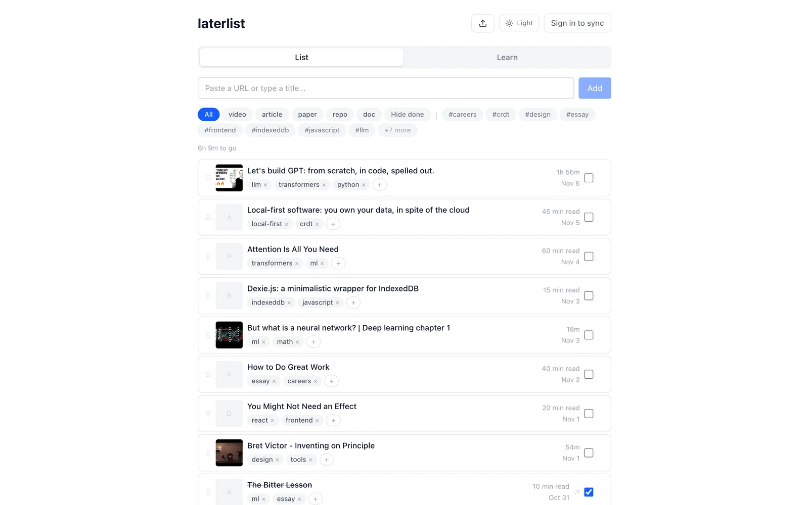
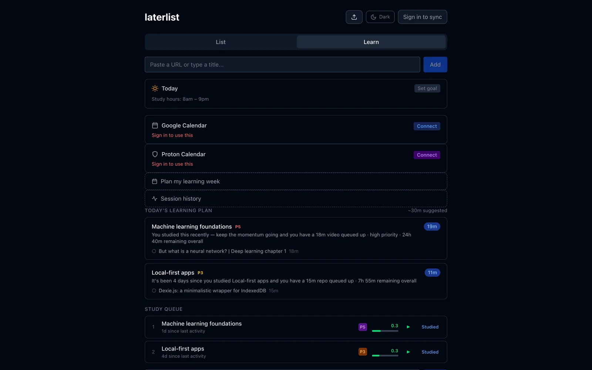
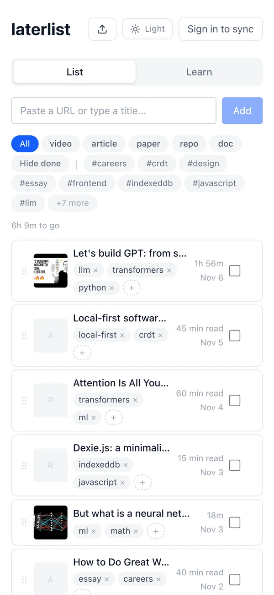

# laterlist

Save any link to read or watch later, then turn the pile into a learning plan.

**Live at [laterlist.cc](https://laterlist.cc)**

<picture>
  <source media="(prefers-color-scheme: dark)" srcset="docs/screenshots/list-dark.webp">
  
</picture>

## Features

- **Paste anything**: a URL (video, article, paper, repo, podcast, doc) or a plain title. Signed-in
  users get AI enrichment: title, category, tags and read or watch time.
- **Local-first**: everything lives in IndexedDB and works offline. Sign in with email or Google
  to sync across devices through Dexie Cloud.
- **Organise**: drag to reorder, edit tags inline, add markdown notes, group items by colour,
  and filter by category or tag. Saving the same URL twice gets a warning.
- **Learn view**: group items into topics with a priority and a time budget. A study queue uses
  spaced repetition to pick what's due, and a daily plan suggests what to do today.
- **Track time**: a timer with an optional Pomodoro mode, manual time logs, a daily goal,
  streaks, a weekly activity chart and weekly or monthly reports.
- **Calendar**: connect Google Calendar or Proton Calendar to find free study slots.
- **YouTube playlists**: import a playlist into a topic and pick which videos to keep.
- **Your data**: JSON export and import (import only adds what's missing), plus a learning
  export as JSON or CSV. Items marked done are archived after 7 days.
- **Light and dark themes**: follows your system until you pick one.

| Learn view | Mobile |
| --- | --- |
|  |  |

## Development

```bash
pnpm install
cp .env.local.example .env.local
pnpm dev             # http://localhost:3000
pnpm test            # Vitest in watch mode
pnpm typecheck
pnpm build
```

The app runs without any keys; each variable turns on a feature.

| Variable | What it enables |
| --- | --- |
| `OPENAI_API_KEY` | AI enrichment in `/api/enrich` |
| `NEXT_PUBLIC_DEXIE_CLOUD_URL` | Sign-in and sync. Create a database with `npx dexie-cloud create`, then `npx dexie-cloud whitelist http://localhost:3000` |
| `KV_REST_API_URL`, `KV_REST_API_TOKEN` | Upstash Redis for server-side data (topics and items for the REST API, API keys, calendar tokens, sessions). Without them, data goes to `.data/` on disk |
| `MCP_USER_EMAIL` | The owner's sign-in email. Routes that touch shared server state (API keys, calendars, sessions, publishing) only answer to this user, and return 503 when it's unset |
| `GOOGLE_CLIENT_ID`, `GOOGLE_CLIENT_SECRET`, `NEXT_PUBLIC_APP_URL` | Google Calendar OAuth |

## How it's built

Next.js 16 (App Router), React 19, TypeScript, Tailwind CSS 4, Dexie 4 with `dexie-cloud-addon`,
dnd-kit, the AI SDK with OpenAI `gpt-4o-mini`, and Vitest. Deployed on Vercel.

| Path | What |
| --- | --- |
| `src/db/index.ts` | Dexie schema: items, groups, topics, time logs and settings |
| `src/app/page.tsx` | The whole UI: the List and Learn views |
| `src/hooks/` | Live queries and the study queue, daily plan, streak and timer logic |
| `src/app/api/enrich/` | Metadata fetch (with private-address blocking) and AI tagging, 10 requests a minute per IP |
| `src/app/api/` | REST API for topics, items, the study queue, search, sessions and calendars |
| `src/lib/server/` | Auth checks, API keys, Redis or file storage, calendar sync |
| `mcp-server/` | An MCP server that exposes the REST API as tools (topics, study queue, time logs, notes, search, bulk import) |
| `docs/` | `openapi.yaml` for the REST API, and the product requirements in `PRD.md` |

To use the MCP server, build it and point it at a running app:

```bash
cd mcp-server && npm install && npm run build
LATERLIST_URL=https://laterlist.cc LATERLIST_API_KEY=ll_... node dist/index.js
```

The owner, signed in, creates API keys with `POST /api/auth/keys`. Until the first key exists,
the routes that take an API key are open.
